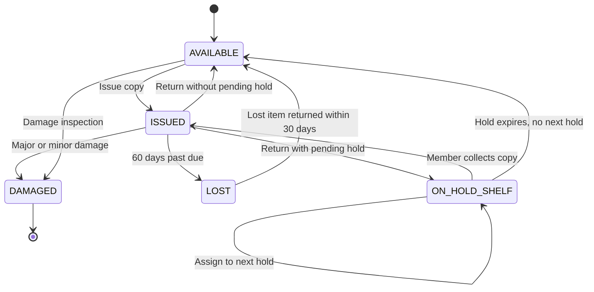
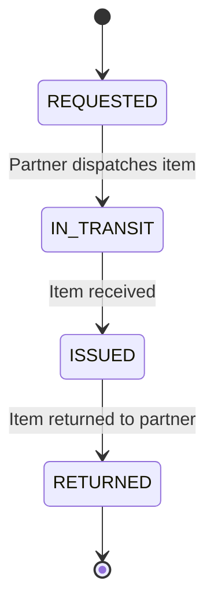

# Library Circulation Engine – State Diagram

**Team ID:** T023  
**Problem Statement:** PS-071

## 1. Copy Lifecycle

The following diagram represents the possible states of a library copy and the transitions between them.

## 2. Inter-Library Loan Lifecycle

## 3. State Descriptions

| State | Description |
|---|---|
| AVAILABLE | Copy is available for borrowing. |
| ISSUED | Copy is currently borrowed by a member. |
| ON_HOLD_SHELF | Copy is reserved and waiting for collection. |
| IN_TRANSIT | Copy is travelling between libraries. |
| LOST | Copy has been declared lost. |
| DAMAGED | Copy is damaged and withdrawn from circulation. |
| RETURNED | An issue transaction has been returned. |

## 4. Transition Rules

1. An available copy can be issued to an eligible member.
2. An issued copy can be returned.
3. If a hold exists, a returned copy moves to ON_HOLD_SHELF.
4. If no hold exists, a returned copy becomes AVAILABLE.
5. An expired hold allows the next eligible member in the queue to receive the copy.
6. An item becomes LOST after 60 days past its due date.
7. A damaged copy is withdrawn from circulation.
8. A lost copy returned within 30 days can be restored to circulation after the required return processing.

## 5. Conclusion

The state diagram describes the lifecycle of library copies and inter-library loan transactions. It helps ensure that invalid state transitions are prevented and that circulation operations follow the business rules.